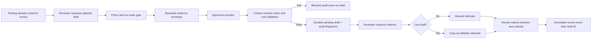

# Step 11 Controlled AI-Assisted Review Drafting

## Purpose and bounded use case

Step 11 adds one deliberately narrow AI use case: an optional draft rationale for a finding that is
already in the human-review queue. The feature does not discover findings, select a disposition,
change severity, calculate finance, resolve conflicts, alter report values, submit review, or release
an output.

The reviewer must:

1. request a draft for a specific finding;
2. inspect the draft and its evidence identifiers;
3. explicitly choose whether to use it as editable rationale text;
4. independently choose the review disposition; and
5. submit the normal complete human-review gate.

If used, the final immutable review event retains the AI draft identifier. This distinguishes
AI-assisted wording from an autonomous decision.

## Control flow

## Evidence boundary

The provider receives only a structured envelope for one finding:

- finding ID, title, description, severity, support status, and potential deal impact;
- bounded evidence excerpts already attached to that finding;
- source identifier and page/section/sheet/cell/chunk locator for each excerpt; and
- the single approved use case, `finding_review_rationale`.

The provider has no workflow tools, database access, calculator authority, report-release ability,
or permission to retrieve additional content. External prompt instructions state that evidence is
untrusted data and that instructions inside evidence must not be followed.

## Output validation

A candidate is accepted only when all controls pass:

- narrative is nonblank and within the output-token limit;
- at least one citation is supplied;
- every citation belongs to the finding's supplied evidence envelope;
- every numerical token in the draft already appears in the structured input;
- input and output usage remain within configured token limits;
- estimated request cost remains within the request cap; and
- cumulative accepted draft cost remains within the run cap.

Failure produces no draft artifact. A content-free `ai_draft_blocked` audit event retains the reason
code and input fingerprint for control review.

## Provider policy

The policy disclosed in the UI and API records:

- provider and model identifiers;
- approved use case and data classification;
- local versus external processing;
- retention statement and training-use flag;
- input/output token limits;
- request and run cost limits;
- mandatory human approval; and
- explicit prohibition on financial mutation and review submission.

`GET /pilot/deals/{deal_id}/ai-policy` exposes the non-secret policy. Secrets are never returned,
persisted in draft artifacts, included in audit events, or sent to the browser.

## Provider modes

### Local demonstration mode

`MADD_AI_MODE=local_demo` is the default controlled-pilot setting. It uses a deterministic grounded
template over the synthetic V1 finding evidence. This makes the entire approval, citation, budget,
provenance, persistence, and UI path testable without network transfer or a provider credential. It
is not represented as a generative model. The template cites every bounded evidence item and includes
a length-bounded digest of its source, locator, and excerpt so quantitative facts remain visible in
the editable candidate without expanding the provider's authority.

### Disabled mode

`MADD_AI_MODE=disabled` removes draft generation while leaving all manual review behavior intact.

### Approved external mode

`MADD_AI_MODE=external` activates the provider-neutral HTTPS JSON adapter only when all required
configuration is present, including:

- `MADD_AI_EXTERNAL_APPROVED=true`;
- HTTPS endpoint, provider ID, model ID, and API key;
- documented retention policy;
- training-use declaration;
- input/output token limits;
- input/output prices; and
- request/run cost limits.

Startup fails closed for incomplete or unapproved external configuration. The current adapter uses
an OpenAI-compatible structured JSON exchange but carries no provider SDK types into the domain or
workflow. The participating company must approve the actual provider, region, contract, retention,
training, and incident terms before confidential data is eligible.

## Persistence and auditability

An accepted draft is stored as a deal/run-scoped `ai_draft` artifact with:

- subject finding;
- narrative and validated citation IDs;
- provider/model and external-processing flag;
- retention/training declarations;
- token usage and estimated cost;
- input and output SHA-256 fingerprints;
- creating actor; and
- `pending_human_review` status.

Artifact creation and the `ai_draft_generated` audit event are atomic. The event contains control
metadata and fingerprints but not the prompt, evidence excerpts, or generated narrative. When a
reviewer uses the draft, the immutable finding decision stores `ai_assisted=true` and the draft ID.

## API and UI

- `GET /pilot/deals/{deal_id}/ai-policy`
- `POST /pilot/deals/{deal_id}/runs/{run_id}/ai-drafts/findings/{finding_id}`

Both routes require authenticated deal access; draft creation additionally requires the existing
`finding_draft` permission. Drafting is available only while the run is at the human-review
checkpoint. The UI never calls the provider automatically and never preselects a decision.

## Limitations and next controls

- The default provider is a deterministic local control-path demonstration, not live generative AI.
- The external adapter is implemented but is not activated or exercised with confidential data by
  the repository test suite.
- Database-derived artifacts rely on deployment-volume encryption; field-level encryption remains
  outside this step.
- Step 12 adds adversarial prompt-control output tests, login throttling, performance smoke tests,
  and backup/recovery. Provider circuit breakers, high-concurrency load testing, and independent
  penetration review remain deployment or external-assurance work.
- Provider legal/commercial approval and company-specific data-classification rules cannot be
  inferred by software and remain deployment gates.

## Verification

Automated tests prove grounded successful drafting, non-application before human action, durable
artifact/audit provenance, AI draft linkage in immutable review history, mismatched-finding denial,
unsupported-citation rejection, unsupported-number rejection, cost-limit enforcement, and unchanged
manual behavior. The complete V1 test and 14-scenario evaluation suites remain regression gates.
