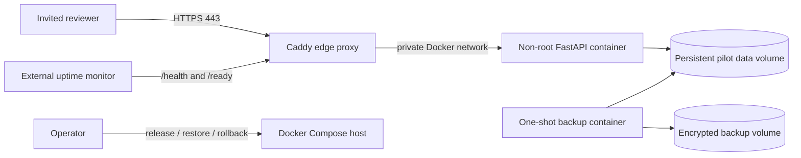

# Pilot Deployment and Operations

## Status and boundary

This document is the repository-owned Step 13 deployment foundation. It provides a hardened
single-instance container, automatic HTTPS reverse proxy, isolated network, persistent volumes,
health and release endpoints, encrypted backup rotation, container smoke testing, and rollback
procedure.

Step 13 is **not complete** until an approved host and hostname are selected, DNS and firewall rules
are applied, secrets are installed outside Git, the stack is started, and an invited reviewer
successfully uses the resulting HTTPS URL. The repository does not claim a live deployment merely
because the image can be built.

## Runtime architecture



- Only Caddy publishes host ports. The application port is not mapped to the host.
- Caddy obtains and renews the certificate and redirects HTTP to HTTPS.
- The application runs as the unprivileged `madd` user with a read-only root filesystem, all Linux
  capabilities dropped, `no-new-privileges`, bounded memory/CPU/PIDs, and a writable data volume.
- The application and proxy share an internal backend network. Caddy also has an edge network so
  it can reach the certificate authority.
- SQLite, encrypted checkpoints, and encrypted document objects remain on one persistent data
  volume. Horizontal replicas are prohibited for this pilot architecture.
- The backup job has no network and receives only the backup key plus the data/backup volumes.

## Deployment prerequisites

Use a dedicated, supported Linux host with Docker Engine and Docker Compose v2. The host requires:

1. a static public IP;
2. a controlled DNS hostname whose A/AAAA record points to that IP;
3. inbound TCP 80 and TCP/UDP 443, with administrative access restricted to approved operators;
4. an encrypted host disk, automatic security updates, accurate system time, and restricted service
   account;
5. sufficient durable capacity for the VDR, checkpoints, database, reports, and retained backups;
6. an approved off-host destination for already-encrypted `.madd-backup` archives.

Do not place confidential pilot files, real secret values, or deployment environment files in Git.

## Secrets and environment isolation

Copy `deploy/.env.pilot.example` to `deploy/.env.pilot` on the host and restrict it to the deployment
service account. Populate the exact hostname, TLS contact, immutable release SHA/image tag, volume
names, invited administrator details, and three independent 32-byte keys:

- `MADD_DOCUMENT_KEY` — encrypted VDR objects;
- `MADD_CHECKPOINT_KEY` — encrypted LangGraph checkpoints;
- `MADD_BACKUP_KEY` — encrypted backup envelopes.

Generate keys on the trusted host with `generate_document_key()` and transfer them directly into the
host secret store. Never print them into tickets, chat, CI logs, or screenshots. Losing a key makes
the associated encrypted data unrecoverable; disclosing it requires incident response and rotation.

Production-like pilot and test environments use different hostnames, volumes, administrators, and
all three keys. `MADD_AI_MODE` remains `local_demo` for the synthetic pilot. External AI mode is a
separate approval decision and must not be enabled as part of deployment.

## Build and release

From a clean checkout of the reviewed commit:

```text
docker compose --env-file deploy/.env.pilot -f deploy/compose.yaml build --pull app
docker compose --env-file deploy/.env.pilot -f deploy/compose.yaml up --detach app caddy
docker compose --env-file deploy/.env.pilot -f deploy/compose.yaml ps
```

The release identity is visible at `GET /version`; it must equal the reviewed commit SHA. The image
must never be promoted under a mutable production tag without also recording the immutable digest.
CI independently builds the container, starts it, checks `/health`, `/ready`, `/version`, the browser
entry point, the Docker health status, and the non-root user.

## HTTPS and acceptance check

After DNS propagation, verify all of the following from a network outside the host:

- `https://<host>/health` returns `{"status":"ok"}`;
- `https://<host>/ready` returns a ready database status;
- `https://<host>/version` returns the intended environment and release SHA;
- HTTP redirects to HTTPS and the certificate chain/hostname are valid;
- HSTS, CSP, anti-framing, no-sniff, referrer, and permissions headers are present;
- the login page loads without browser console or network errors;
- an invited reviewer can sign in, open only an assigned deal, run the labelled synthetic analysis,
  complete review, and download the reviewed PDF and workbook;
- an analyst cannot perform reviewer-only actions and another deal remains undiscoverable.

The stable URL is not accepted until this reviewer journey and the backup/restore drill below pass.

## Monitoring and alerting

Configure an independent HTTPS monitor, not a process inside the same host:

| Signal | Suggested pilot check | Alert condition |
| --- | --- | --- |
| Liveness | `GET /health` every minute | Two consecutive failures |
| Readiness | `GET /ready` every minute | Any sustained `503` |
| Release | `GET /version` after deployment | SHA/environment mismatch |
| TLS | Certificate expiry | Less than 21 days |
| Container | Restart/health status | Unplanned restart or unhealthy |
| Disk | Data and backup volume use | Warning at 70%, critical at 85% |
| Backup | Latest verified archive timestamp | Older than 26 hours |
| Login | Repeated `429`/authentication failures | Material unexplained increase |

Caddy emits JSON access logs to standard output. Tokens stay in the Authorization header and must
never be copied into log enrichment, URLs, analytics, or support screenshots. Set log retention and
access according to the pilot data policy.

## Backup schedule and custody

Run the one-shot backup service after deployment and then daily during the pilot:

```text
docker compose --profile ops --env-file deploy/.env.pilot -f deploy/compose.yaml run --rm backup
```

The command creates a consistent encrypted archive, verifies it immediately, and keeps the newest
`MADD_BACKUP_RETAIN_COUNT` safely named archives. Unrelated files are never removed. Copy verified
encrypted archives from the backup volume to the approved off-host destination; apply an independent
retention policy there. The backup key must be stored separately from both locations.

At least once before inviting reviewers, restore a selected archive into a **new** volume and data
subdirectory, point a temporary isolated stack at that restored state, and verify `/ready`, database
records, document decryption, paused-run recovery, and review history. Never test recovery by
overwriting the active volume.

## Rollback

### Application-only rollback

1. Stop user access or place the pilot in an announced maintenance window.
2. Record the failing release SHA and preserve logs.
3. Select the last verified image digest whose database schema is compatible.
4. Set `MADD_IMAGE_TAG` and `MADD_RELEASE_SHA` to that release and recreate `app` only.
5. Verify `/health`, `/ready`, `/version`, login, deal isolation, and one read-only workflow path.

### Application-and-data recovery

1. Stop `app` and `caddy`; do not delete either active volume.
2. Create a new named data volume.
3. Mount that volume at `/data-root` in the one-shot backup container and restore the chosen archive
   into a new absent subdirectory such as `/data-root/restored`.
4. Change `MADD_PILOT_DATA_VOLUME` and `MADD_DATA_SUBDIRECTORY` to the new volume/subdirectory and
   select the matching verified image release.
5. Start the stack, run the complete acceptance check, and retain the prior volume until the incident
   review authorizes disposal.

Rollback is a controlled release operation, not `git reset`, manual SQLite editing, or deletion of
the current volume.

## Operator response guide

- **`/health` fails:** inspect container state and recent logs; restart only after recording the
  failure and confirming disk/key/config availability.
- **`/ready` returns `503`:** treat the database as unavailable or corrupt; stop writes, preserve the
  volume, and begin the restore decision process.
- **TLS fails:** keep the application port private; inspect DNS, firewall, clock, and Caddy logs.
- **Disk threshold breached:** pause uploads, take and export a verified backup, then expand storage
  under change control.
- **Key or credential exposure:** suspend access, preserve audit evidence, notify the pilot owner,
  rotate affected secrets, and evaluate data re-encryption/restoration.
- **Suspected cross-deal access or report-integrity failure:** stop the pilot immediately. These are
  critical incidents, not warnings to defer.

## Live completion evidence still required

The operator must record the approved hostname, host owner, release SHA/image digest, deployment
time, certificate result, firewall review, monitoring destination, last verified backup, restore drill,
invited reviewer, and acceptance outcome. Only then may Step 13 be marked complete and Step 14 begin.
