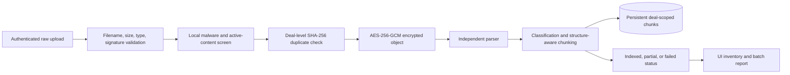

# Step 7 Pilot Document Processing

## Purpose and boundary

Step 7 adds a real, deal-scoped document intake path to the controlled pilot. Each upload is
validated, screened before storage, encrypted, parsed independently, classified, chunked, and
reported with a durable processing status. A bad file cannot silently disappear or discard the rest
of its batch.

This step does not replace the verified synthetic VDR used by the diligence workflow. Connecting
real pilot chunks to evidence retrieval and optional model-assisted interpretation remains a later,
controlled integration. Until that integration is verified, the analysis screen continues to label
its 25-document run as synthetic.

## Supported input

The intake boundary accepts PDF, XLSX, CSV, UTF-8 TXT/Markdown, and basic HTML. The default maximum
is 50 MiB per file and can be reduced with `MADD_MAX_UPLOAD_BYTES`.

The server checks all of the following rather than trusting the browser:

- authenticated deal-level `document_write` permission;
- safe basename, bounded filename, and valid batch identifier;
- non-empty content and configured size limit while streaming the request;
- extension and media-type allow-list;
- PDF, XLSX, and text-content signatures;
- valid XLSX container structure, expansion bounds, entry count, embedded active files, and macros;
- the EICAR test signature and disguised Windows executable headers;
- exact duplicates within the deal using SHA-256.

Rejected attempts are not written to encrypted object storage. They are retained as append-only
audit events with batch, filename, reason code, actor, and timestamp. The local deterministic screen
is a pilot safety layer, not a claim of equivalence to a maintained enterprise anti-malware service.
The deployment/security stage must validate or replace it with the participating company's approved
scanner before external company data is accepted.

## Storage and processing flow

Blob registration and the initial upload audit event remain atomic. Processing then replaces that
document's persisted chunk set and writes its final status plus processing audit event in one
transaction. Failed parsing retains the encrypted source, failure reason, and empty chunk set so an
authorized user can diagnose or retry it later.

## OCR and table handling

The pilot parser can request OCR for PDF pages without extractable text through PyMuPDF's Tesseract
integration. Missing OCR support or a page-level OCR failure is visible in the warnings and may make
the document partial or failed; it never fabricates text.

PDF table discovery is enabled for the pilot path. Extracted rows retain page, table, row, and header
context. CSV and XLSX rows continue to remain atomic, with sheet, row, cell-range, and header
provenance. The parser never evaluates spreadsheet formulas or executes macros.

## Durable processing report

Every accepted document exposes:

- encrypted-source checksum and byte size;
- batch and processing stage;
- indexed, partial, or failed status;
- deterministic document type and workstreams;
- page, parsed-element, table-row, and chunk counts;
- parser warnings and structured failure issues;
- append-only upload and processing audit events.

Each normalized chunk is persisted under the deal and stored document ID with its text, workstreams,
document type, page indexes, section, clause, table/sheet/row coordinates, content fingerprint, and
source filename. Temporary plaintext parsing files are deleted after each attempt.

The batch endpoint reports accepted status counts and rejected items. The browser uploads selected
files independently, reports per-file rejection reasons, and refreshes the durable inventory when the
batch finishes.

## API

- `GET /pilot/deals/{deal_id}/documents`
- `POST /pilot/deals/{deal_id}/documents`
- `GET /pilot/deals/{deal_id}/document-batches/{batch_id}`

Upload bodies contain one raw file. Required headers are `X-Filename`, `X-Upload-Batch`,
`Content-Type`, and the bearer authorization header. The server does not rely on UI visibility for
authorization.

## Known limitations and next controls

- The local content screen is deliberately bounded; approved enterprise malware scanning is still a
  deployment/security gate.
- OCR requires a working Tesseract integration on the host and remains best-effort.
- Password-protected PDFs and legacy `.xls` files are rejected or fail transparently.
- Scanned tables, complex merged cells, charts, images, and formula semantics may require specialist
  extraction adapters.
- Uploaded chunks are persisted but are not yet allowed to influence the synthetic report.
- Retry, replacement, deletion, and richer version-management interactions remain future UI work.

## Verification

Automated tests cover successful CSV processing and chunk persistence, encrypted-source metadata,
recoverable PDF parse failure, malicious-content rejection, duplicate rejection, validation and
size limits, audit history, batch status, authorization, and cross-deal denial. The original VDR
ingestion suite remains unchanged to prove the optional OCR/table settings do not alter the frozen
default parser behavior.
