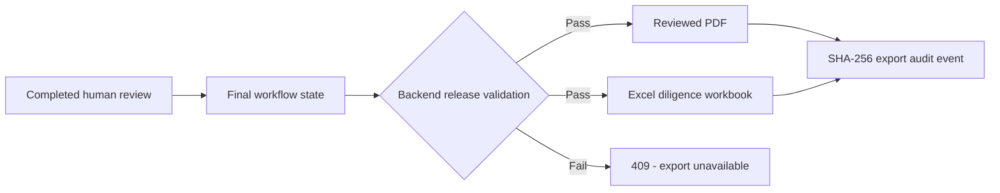

# Step 10 Reviewed Report and Excel Exports

## Purpose and release boundary

Step 10 turns the released application state into two professional, portable deliverables:

- a reviewed PDF diligence report; and
- an Excel workbook containing the findings register, citations, review history, and deterministic
  financial schedules.

Exports are a presentation layer, not a second analysis engine. They are generated from the same
final report, reviewed findings, financial snapshot, limitations, and immutable review events shown
in the application. A run that is still awaiting review, waiting for information, failed, or missing
its final report or financial results cannot be exported.

## Reviewer workflow

The Report screen now presents individual findings, citations, the deterministic financial summary,
explicit limitations, and validation control totals before offering either download.

## PDF report

The PDF contains:

- confidential controlled-pilot marking, target, buyer, transaction, as-of date, run identifier,
  generation time, and final human-review status;
- control totals for final findings, report citations, and immutable review-history events;
- the exact released financial summary with currency and unit;
- every report section and its released findings;
- finding severity, support status, final analyst-review status, uncertainty, decision rationale,
  reviewer identity, and decision timestamp;
- evidence identifiers, source-document identifiers, locators, and available source excerpts;
- information-request identifiers, explicit report limitations, and overall review certification;
- page-level confidentiality headers and footers.

Unknown values are displayed as `Unknown`; they are never converted to zero.

## Excel workbook

The workbook contains 12 formatted sheets:

1. `Read Me` — deal metadata, release status, control totals, and use constraints.
2. `Findings Register` — one row per final finding, including status, support, materiality, impacts,
   evidence, and the immutable reviewer decision.
3. `Citations` — one row per finding/evidence link with document and granular locator fields.
4. `Financial Summary` — the exact headline values in the final report.
5. `EBITDA Bridge` — signed deterministic bridge lines, sources, evidence, result, and warnings.
6. `Working Capital` — period-by-period input lines and calculated NWC results.
7. `NWC Peg` — method, included periods, normalized/current NWC, and surplus or shortfall.
8. `Customer Concentration` — customer revenue schedule, evidence, and concentration outputs.
9. `Net Debt` — signed bridge lines, sources, evidence, result, and warnings.
10. `Revenue Reconciliation` — competing source observations, basis, period, preferred source,
    variances, and rationale.
11. `Review History` — ordered actor, subject, action, rationale, and before/after state.
12. `Limitations` — the exact explicit limitations from the final report.

The workbook exports the deterministic formulas as descriptions beside their signed source lines and
results. It deliberately does not introduce separate editable Excel formulas that could diverge from
the validated application calculation.

## API and authorization

- `GET /pilot/deals/{deal_id}/runs/{run_id}/exports/report.pdf`
- `GET /pilot/deals/{deal_id}/runs/{run_id}/exports/workbook.xlsx`

Every request requires an authenticated user with read access to that deal. Cross-deal and unknown
run lookups return the same non-disclosing `404`. Successful responses use attachment filenames,
the exact media type, `Cache-Control: no-store`, `X-Content-Type-Options: nosniff`, and an
`X-Export-SHA256` digest.

Each successful download appends a deal-scoped audit event containing the actor, run, filename,
media type, byte count, and SHA-256 digest. Export contents and access tokens are not written to the
audit log. Files are generated in memory and are not committed to Git or retained as unencrypted
server artifacts.

## Controls and limitations

- The current PDF and workbook represent the synthetic V1 workflow until a later verified step
  connects uploaded customer documents to analysis.
- The PDF is a controlled professional pilot layout, not a company-specific house-style template.
- The workbook is an export, not a replacement for the application's validation and audit controls.
- Exporting records delivery but does not implement external document-rights management, recipient
  revocation, watermark identities, or downstream secure sharing.
- Qualified finance, accounting, legal, tax, cyber, and transaction professionals remain responsible
  for conclusions and use of the deliverables.

## Verification

Automated tests complete the real reviewer release flow, download both files, reopen the PDF and
workbook, and compare target, financial values, finding counts, severities, review status,
limitations, sheet inventory, and audit digests with application state. Negative tests prove that
unreleased, unauthenticated, and cross-deal export requests fail closed. The complete V1 test and
14-scenario evaluation suites remain regression gates.
