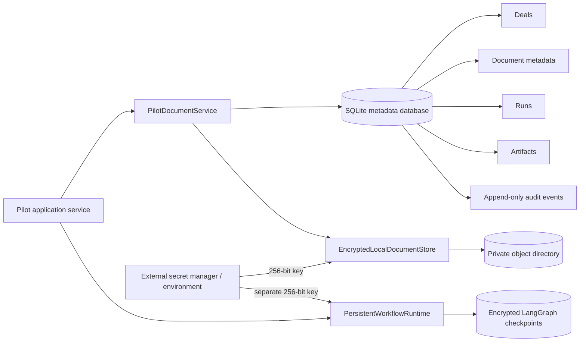

# Pilot Persistence and Encrypted Document Storage

## Scope

This milestone introduces the first durable pilot boundary. It does not add authentication or API
upload endpoints; those remain later steps in the locked implementation plan.

## Architecture

The relational repository stores deal-scoped metadata. Uploaded bytes are encrypted separately and
are never placed in the database or Git repository.

## Database controls

- SQLite schema version 1 with an explicit migration table
- Foreign keys enabled on every connection
- Deal ID retained on documents, runs, artifacts, and audit events
- Deal-scoped reads require both deal ID and resource ID
- WAL mode and a bounded busy timeout for controlled single-service use
- Canonical JSON for structured run and artifact payloads
- Decimal-like financial values stored as strings inside typed payloads rather than floating point
- Append-only audit-event API
- Atomic document-metadata and audit-event registration
- Durable LangGraph pause/resume state through the official SQLite checkpointer
- Authenticated checkpoint encryption with a key separate from document encryption

SQLite is intentionally acceptable only for the first single-instance controlled pilot. A broader
or highly concurrent deployment should implement the same repository boundary using a managed
relational database and formal migration tooling.

## Document encryption controls

- AES-256-GCM authenticated encryption
- Unique random 96-bit nonce for each stored blob
- A 256-bit key supplied externally through `MADD_DOCUMENT_KEY`
- Deal ID, document ID, and expected plaintext checksum bound as authenticated associated data
- SHA-256 integrity verification after decryption
- Random opaque storage keys; original filenames never appear in storage paths
- Deal partition derived from a one-way hash rather than a raw deal identifier
- Atomic temporary-file write followed by replacement
- Restrictive local permissions where supported
- Strict storage-key validation and root-containment checks
- Compensating encrypted-blob cleanup if database registration fails

Application encryption does not replace operating-system or cloud controls. The deployed storage
volume must also restrict the service account, encrypt the underlying disk, provide backups, and
apply the agreed retention and deletion policy.

## Stored resources

| Resource | Purpose |
| --- | --- |
| Deal | Scope, target, buyer, transaction, currency, date, unit, workstreams, and status |
| Document | Filename metadata, opaque storage key, SHA-256, size, media type, status, and processing metadata |
| Run | Deal-scoped workflow status, review policy, and schema-controlled state snapshot |
| Artifact | Versioned finding, calculation, conflict, request, review, report, or workflow payload |
| Audit event | Actor, action, object, detail, and timestamp in append order |

## Key management

Generate a key through the application helper or an approved secret-management process. Store the
encoded value in the deployment secret manager; never put it in `.env.example`, source code, test
fixtures, logs, command history, or Git.

The first adapters support one active document key and one active checkpoint key. Key identifiers,
rotation, re-encryption, recovery, and hardware-backed custody must be addressed before a production
deployment.

## Failure behavior

- Missing or malformed encryption keys stop startup rather than falling back to plaintext.
- A blob cannot be decrypted under a different deal, document ID, or checksum context.
- Database foreign keys reject orphaned records.
- Cross-deal retrieval returns no object even if another deal's resource ID is known.
- Duplicate global identifiers raise a typed persistence conflict.
- If blob encryption succeeds but database registration fails, the new encrypted blob is removed.
- Individual resources are never silently reassigned to another deal.
- A paused human-review workflow can be reopened and resumed after the application process restarts.
- Checkpoint tampering or use of the wrong key fails authenticated decryption.

## Current limitations

- SQLite is not a multi-instance production database.
- Step 12 adds encrypted backup, verification, and restore tooling; scheduling, off-host custody,
  recovery objectives, rotation, secure deletion, retention automation, and storage reconciliation
  still require deployment-level operational validation.
- The authenticated pilot API is wired to these adapters. SQLite remains appropriate only for the
  single-instance controlled pilot.
- Step 7 adds upload limits, deterministic screening, OCR/table extraction, and recoverable
  processing status. Enterprise antivirus or sandbox scanning remains a deployment decision.
- Database contents rely on deployment-volume encryption; application-level field encryption is not
  included in this milestone.

See [Pilot Security and Test Gate](PILOT_SECURITY_TESTING.md) for the current cross-stage control
matrix and residual risks.

## Verification

Automated tests cover encrypted round trips, ciphertext confidentiality, deal/document context
binding, traversal rejection, key validation, explicit deletion, database reopening, schema version,
foreign keys, cross-deal query isolation, durable deals/documents/runs/artifacts/audit events, run
updates, atomic document registration, and compensating blob cleanup.
The suite also executes a real LangGraph pause, closes the application runtime, reopens the encrypted
checkpoint database, restores the review state, resumes it, and validates the completed report.
