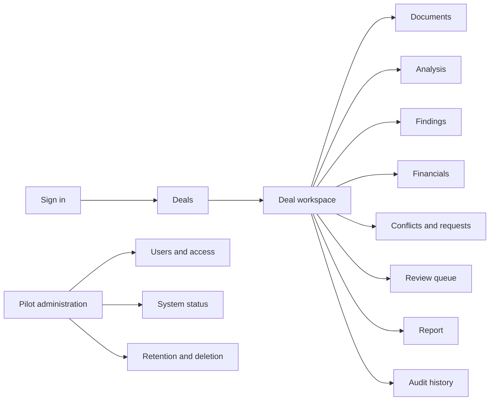
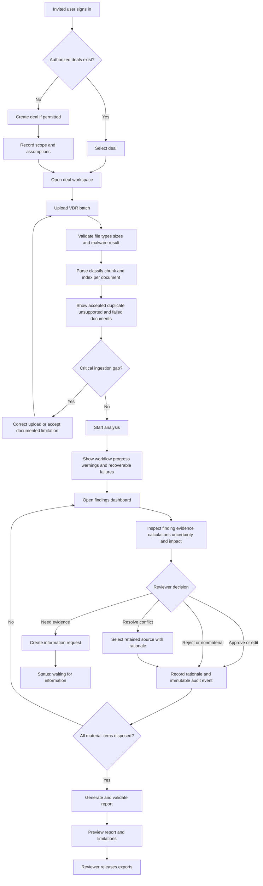

# Pilot User Journey and Wireframes

## Design objective

The pilot interface must let an M&A reviewer complete the agreed diligence journey without using
the command line or raw API. It should optimize for evidence inspection, financial reproducibility,
human control, and visible limitations rather than decorative analytics.

## Pilot roles

| Role | Allowed actions |
| --- | --- |
| Analyst | Create assigned deals, upload documents, start runs, inspect evidence, draft review decisions, and export authorized outputs. |
| Reviewer | All analyst actions plus approve, reject, reclassify, resolve conflicts, request information, and release reports. |
| Pilot administrator | Invite/deactivate users, assign roles and deals, inspect operational status and audit events, apply retention/deletion procedures. |

The first pilot does not need configurable custom roles. Authorization must still be enforced by the
backend; hiding a button in the browser is not an access-control mechanism.

## Navigation model



Deal identity, target name, workflow status, as-of date, reporting currency, and current reviewer
must remain visible throughout the deal workspace.

## Complete user journey



## Global application shell

```text
+----------------------------------------------------------------------------------+
| M&A Due Diligence                    Deal: Project Northstar   User: A. Reviewer |
+----------------------+-----------------------------------------------------------+
| Deals                | Target: SecureTech        Status: Review required         |
| Overview             | As of: 30 Jun 2026        Currency: GBP                   |
| Documents            +-----------------------------------------------------------+
| Analysis             |                                                           |
| Findings             |                 Current page content                      |
| Financials           |                                                           |
| Conflicts & requests |                                                           |
| Review queue         |                                                           |
| Report               |                                                           |
| Audit history        |                                                           |
+----------------------+-----------------------------------------------------------+
```

The shell deliberately avoids a generic chatbot as the primary interface. Search or “ask the VDR”
may be added later, but the pilot's principal workflow is structured and reviewable.

## Screen 1 — Sign in

```text
+----------------------------------------------------------+
| M&A Due Diligence                                       |
|----------------------------------------------------------|
| Work email        [___________________________________]  |
| Password          [___________________________________]  |
|                                                          |
|                                   [Sign in]              |
| Authorized pilot users only                             |
+----------------------------------------------------------+
```

Required states: normal, invalid credentials, locked/deactivated user, expired session, and
temporary service failure. Password reset can be administrative for the first controlled pilot.

## Screen 2 — Deal list

```text
+----------------------------------------------------------------------------------+
| Deals                                                        [+ Create deal]     |
|----------------------------------------------------------------------------------|
| Deal / target       Status                 Documents   Findings   Last activity  |
| Project Northstar   Review required        25          14         25 Oct 2026    |
| Project Cedar       Waiting for documents  0           —          24 Oct 2026    |
+----------------------------------------------------------------------------------+
```

Users see only assigned deals. Search and sorting are optional until the pilot contains enough deals
to justify them.

## Screen 3 — Create deal and scope

```text
+----------------------------------------------------------------------------------+
| Create deal                                                                      |
|----------------------------------------------------------------------------------|
| Deal name*             [Project Northstar                                      ] |
| Target company*        [SecureTech                                             ] |
| Buyer / acquirer       [Northstar Holdings                                     ] |
| Transaction type       [Acquisition v]                                           |
| Reporting currency*    [GBP v]          As-of date* [30/06/2026]                |
| Materiality threshold  [1,000,000]       Unit [Actual v]                         |
| Workstreams            [x] Financial [x] Commercial [x] Legal [x] Operational   |
| Notes / scope limits   [______________________________________________________]  |
|                                                      [Cancel] [Create deal]      |
+----------------------------------------------------------------------------------+
```

No analysis starts until required scope, unit, currency, and date fields validate.

## Screen 4 — Document upload and inventory

```text
+----------------------------------------------------------------------------------+
| Documents                                         [Upload files] [Upload folder] |
|----------------------------------------------------------------------------------|
| Processing: 21 accepted | 1 duplicate | 1 unsupported | 2 failed                |
| [===============================================>........] 84%                    |
|----------------------------------------------------------------------------------|
| File                 Type          Period    Status       Detail                  |
| FY25 accounts.pdf    Financial     FY25      Indexed      32 chunks               |
| customer_data.xlsx   Commercial    LTM       Indexed      4 sheets                |
| SPA v2.pdf           Legal         Current   Duplicate    Matches SPA final.pdf   |
| scan.pdf             Unknown       —         OCR failed   Review required         |
+----------------------------------------------------------------------------------+
```

Each row opens document metadata, checksum, detected versions, pages/sheets, processing warnings,
and retry or removal controls. “Analysis ready” must never imply that failed documents were read.

## Screen 5 — Analysis progress

```text
+----------------------------------------------------------------------------------+
| Analysis run 2026-10-25-001                                      [View run log]  |
|----------------------------------------------------------------------------------|
| ✓ Validate engagement                                                         |
| ✓ Ingest VDR                         2 document warnings                         |
| ✓ Build retrieval index                                                       |
| ✓ Retrieve core evidence                                                       |
| ✓ Financial analysis                                                          |
| ✓ Specialist analysis                 4 completed, 0 failed                     |
| ! Human review                       7 reasons require attention                |
| ○ Final report                        Waiting                                   |
+----------------------------------------------------------------------------------+
```

Statuses: queued, running, retrying, review required, waiting for information, failed,
completed with warnings, and completed. A page reload must not lose progress.

## Screen 6 — Executive overview

```text
+----------------------------------------------------------------------------------+
| Overview                    Status: Review required       7 items need attention  |
|----------------------------------------------------------------------------------|
| Material findings: 14   Critical: 1   High: 5   Open requests: 15               |
|----------------------------------------------------------------------------------|
| Priority findings                                                               |
| [Critical] Revenue sources disagree by GBP 8.0m              [Open finding]      |
| [High]     Largest customer represents 42% of revenue        [Open finding]      |
| [High]     Change-of-control consent remains unresolved      [Open finding]      |
|----------------------------------------------------------------------------------|
| Financial summary                                                               |
| Adjusted EBITDA GBP 15.0m | Normalized NWC GBP 9.31m | Net debt GBP 20.0m      |
| Every number opens its formula, inputs, period, unit, and evidence.              |
+----------------------------------------------------------------------------------+
```

Counts and financial values are navigation aids, not unsupported management conclusions.

## Screen 7 — Findings register

```text
+----------------------------------------------------------------------------------+
| Findings  [All workstreams v] [All severities v] [Open review v]                |
|----------------------------------------------------------------------------------|
| Severity  Workstream   Finding                          Support       Review      |
| Critical  Financial    Revenue sources disagree        Conflicting   Open        |
| High      Commercial   Customer concentration          Supported     Approved    |
| High      Legal        Change-of-control consent       Incomplete    Open        |
| Medium    Operational  Supplier dependency             Supported     Edited      |
+----------------------------------------------------------------------------------+
```

Filters should reflect real reviewer tasks: workstream, severity, support status, review status,
assignee, and information-request status.

## Screen 8 — Finding and evidence review

```text
+---------------------------------------+------------------------------------------+
| Finding                              | Supporting evidence                       |
|--------------------------------------|-------------------------------------------|
| Revenue sources disagree by GBP 8.0m | Audited accounts · p. 42                 |
| Critical · Financial · Conflicting   | “FY25 revenue ... GBP 108m”              |
|                                      |-------------------------------------------|
| Deal impact                          | Management presentation · p. 15           |
| Valuation and earnings reliability   | “FY25 revenue ... GBP 100m”              |
|                                      |-------------------------------------------|
| Uncertainty                          | Source comparison                          |
| Periods match; source authority open | Same entity ✓  Same period ✓             |
|                                      | Same currency/unit ✓  Values differ !     |
| [Approve] [Edit] [Reject]            |                                          |
| [Resolve conflict] [Request evidence]| [Open source document]                   |
+---------------------------------------+------------------------------------------+
| Decision rationale* [_________________________________________________________]  |
+----------------------------------------------------------------------------------+
```

Evidence and finding must remain visible together. Review actions require rationale and use a
confirmation step that summarizes the resulting state.

## Screen 9 — Financial analysis

```text
+----------------------------------------------------------------------------------+
| Financial analysis                                                              |
|----------------------------------------------------------------------------------|
| Reported EBITDA                                                     GBP 12.0m    |
| + Accepted restructuring adjustment                                 GBP 2.0m    |
| + Accepted owner-cost adjustment                                     GBP 1.0m    |
| = Diligence-adjusted EBITDA                                          GBP 15.0m    |
|----------------------------------------------------------------------------------|
| [Open formula] [Inspect adjustment evidence] [Review rejected adjustments]       |
|----------------------------------------------------------------------------------|
| Revenue | Margins | Customer concentration | Working capital | Net debt          |
+----------------------------------------------------------------------------------+
```

Every calculation view shows formula, input values, currency, unit, period, basis, source,
assumptions, exclusions, and reviewer status. Unknown inputs display as unknown, never zero.

## Screen 10 — Conflicts and information requests

```text
+----------------------------------------------------------------------------------+
| Conflicts and requests                                                          |
|----------------------------------------------------------------------------------|
| Unresolved conflicts                                                            |
| Revenue FY25: Audited GBP 108m vs Management GBP 100m       [Resolve]           |
|----------------------------------------------------------------------------------|
| Information requests                                                            |
| Urgent | Provide executed customer contract and consent status | Open           |
| High   | Reconcile FY25 revenue variance                       | Draft          |
|                                                      [Export request list]       |
+----------------------------------------------------------------------------------+
```

Resolving a conflict does not delete the unselected source claim. Both remain in the audit record.

## Screen 11 — Review queue

```text
+----------------------------------------------------------------------------------+
| Review queue                                      3 of 7 material items reviewed |
|----------------------------------------------------------------------------------|
| [ ] Revenue source conflict            Critical   Unassigned    Open             |
| [x] Customer concentration             High       A. Reviewer   Approved         |
| [ ] Change-of-control consent           High       A. Reviewer   Open             |
|----------------------------------------------------------------------------------|
| Report release blocked: 4 material items do not have a final disposition.        |
+----------------------------------------------------------------------------------+
```

The release gate is computed by the backend. The UI cannot bypass unresolved mandatory review.

## Screen 12 — Report preview and export

```text
+----------------------------------------------------------------------------------+
| Diligence report                      Status: Draft — release validation pending  |
|----------------------------------------------------------------------------------|
| Executive summary | Financial | Commercial | Legal | Operational | Appendix      |
|----------------------------------------------------------------------------------|
| Report preview with numbered findings, citations, limitations, and review status |
|----------------------------------------------------------------------------------|
| Validation: 14 findings | 22 citations | 0 unsupported material conclusions      |
|                                             [Export draft] [Release reviewed]     |
+----------------------------------------------------------------------------------+
```

Only a reviewer can release a final report. Draft exports are visibly watermarked as draft and
include scope and limitations.

## Screen 13 — Audit history

```text
+----------------------------------------------------------------------------------+
| Audit history                                                                   |
|----------------------------------------------------------------------------------|
| Time          Actor        Object          Action          Rationale             |
| 14:22         A. Reviewer  Finding F-003   Severity high→critical                |
| 14:18         System       Run R-001       Review required  7 policy reasons      |
| 14:05         R. Analyst   Document D-014  Uploaded         SHA-256 recorded      |
+----------------------------------------------------------------------------------+
```

Audit entries are append-only to users. Corrections create new events rather than replacing history.

## Screen and workflow state matrix

| Workflow status | Primary user action | Report availability |
| --- | --- | --- |
| Created | Upload documents | None |
| Ingesting / analyzing | Monitor progress and inspect warnings | None |
| Review required | Dispose material items | Draft only when generated by policy |
| Waiting for information | Upload/attach requested evidence and restart affected analysis | None or stale draft clearly marked |
| Failed | Inspect actionable error and retry permitted step | None |
| Completed with warnings | Review warnings and release if policy permits | Reviewed export |
| Completed | Inspect and export | Reviewed export |

## Accessibility and usability requirements

- Keyboard-operable navigation, upload, filtering, evidence opening, and review actions
- Visible focus, descriptive labels, logical heading order, and status text independent of color
- Dates, currency, units, negative values, and decimal precision displayed consistently
- No evidence or rationale available only on hover
- Confirmation before consequential review or deletion actions
- Plain-language failure messages with an operator trace identifier
- Responsive desktop layout; mobile optimization is outside the initial pilot

## Backend capability gaps exposed by this design

The current V1 API is fixture-only and process-local. The UI cannot be implemented honestly until
the following backend contracts exist:

1. Authentication, sessions, users, and roles
2. Deal creation, assignment, listing, and authorization
3. Secure multipart document upload and per-document processing status
4. Persistent document, run, finding, calculation, review, audit, and report resources
5. Background-run creation and progress retrieval
6. Finding list/detail and evidence document/locator retrieval
7. Financial bridge and calculation-line retrieval
8. Conflict and information-request resources
9. Report validation, preview, release, and export endpoints
10. Administrative health, retention, and deletion operations

These gaps define Stages 4 and 5 of the locked implementation plan. The frontend should consume
versioned public API contracts rather than import internal workflow objects.

## Stage exit criteria

This UX design is ready to proceed when:

- Every in-scope action in `PILOT_SCOPE.md` maps to a screen and backend-enforced state transition.
- Material findings always lead to evidence and human disposition.
- Every displayed financial result leads to reproducible calculation detail.
- Failures, missing information, contradictions, and limitations are visible.
- A finance reviewer can understand the terminology without developer assistance.
- The design creates no route around authorization, evidence validation, or report-release policy.
